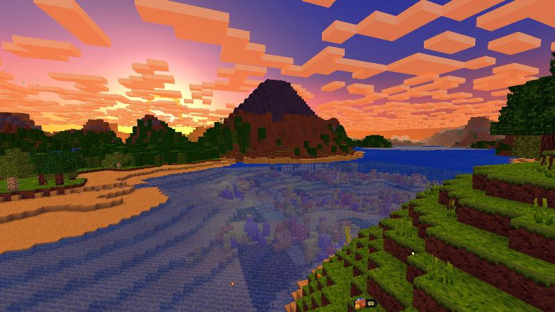
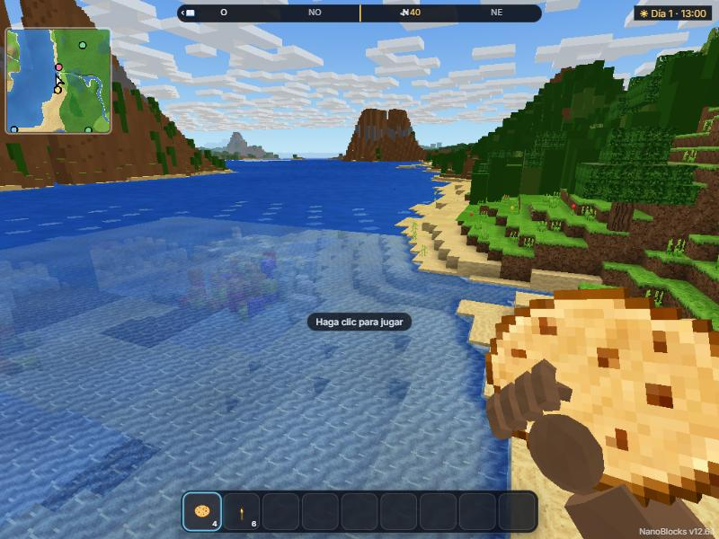
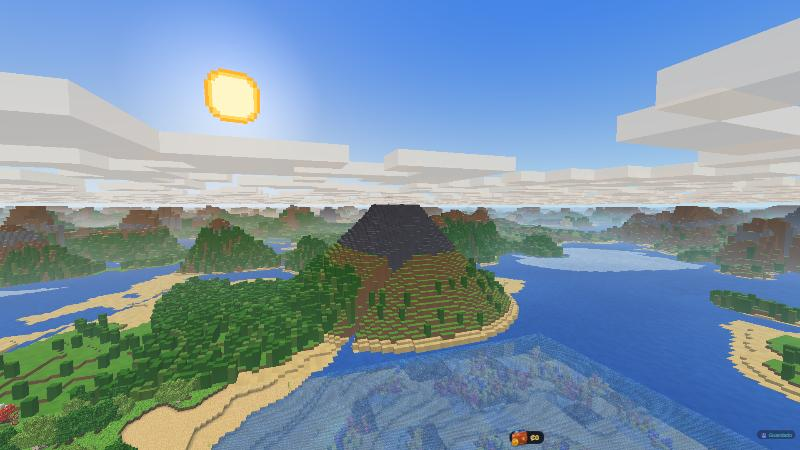
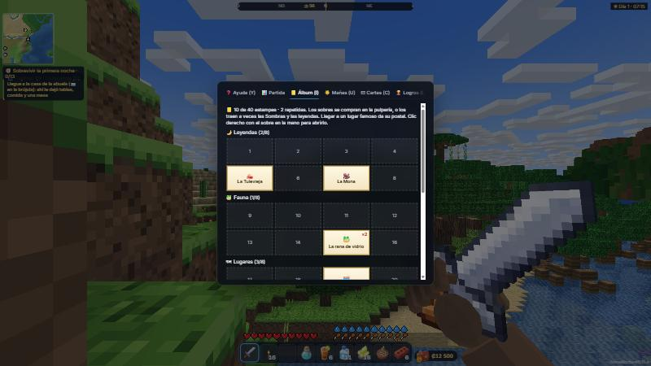

# NanoBlocks

**NanoBlocks** es un juego de bloques en 3D, hecho para jugarse en el navegador, ambientado en una Costa Rica inventada y de bolsillo: playas, volcanes, selva, pueblos con su gente, oficios y criaturas de leyenda. Todo en él es original: los nombres, el arte, las criaturas y el estilo.



## Cómo jugar

1. Abra **https://nanoyackson.github.io/nanoblocks/** en un navegador moderno (Chrome, Edge o Firefox, en computadora).
2. Pulse «Un jugador», cree un mundo (puede escribir una semilla o dejarla vacía) y haga clic para empezar.
3. **Instálelo como app (opcional):** en Chrome o Edge, use el ícono de instalar de la barra de direcciones (o el menú → «Instalar NanoBlocks»).

Su partida se guarda sola en el navegador y también puede exportarla e importarla como archivo desde el menú de mundos.

### Controles básicos

| Acción | Tecla |
|---|---|
| Moverse | W A S D |
| Saltar / nadar hacia arriba | Espacio |
| Agacharse | Shift |
| Correr | Ctrl o doble W |
| Romper / usar / colocar | clic izquierdo / clic derecho |
| Elegir objeto | 1–9 o la rueda |
| Inventario | E |
| Chat y comandos | T o / |
| Soltar objeto | Q |
| Ayuda | F1 |
| Pausa y menú | Esc |

Dentro del juego, la pestaña **Ayuda** del menú trae la lista completa.



## Lo que trae

- **Un mundo generado por semilla**, con biomas de costa, selva, montaña y volcán, ríos, arrecifes y tortugas, y una opción de mapa **compacto** (la «Tiquicia de bolsillo»).
- **Pueblos con gente**: vecinos con oficios, tiendas, un tablón de encargos y una economía en colones.
- **Oficios y vida cotidiana**: cocinar en el fogón, guardar en la despensa, cultivar la finca, pescar y fabricar.
- **Jefes**: 23 jefes, con su Rey Zopilote, para enfrentar con armas, armadura y estrategia.
- **Libreta** con logros, un álbum de estampas, cartas y bestiario, con criaturas y leyendas de la tradición costarricense.
- **Clima y hora del día**: atardeceres, lluvia, temporadas de verano e invierno.
- **Calidad gráfica ajustable** (Bajo, Medio, Alto, Ultra) con horizonte lejano y ajuste automático según su equipo.





## Jugar con amistades

NanoBlocks se puede jugar en línea con amistades, sin servidor propio: quien abre la partida es el **anfitrión** y comparte un **código de sala**; los demás entran con ese código y el anfitrión los aprueba. Se construye junto, cada quien guarda su ficha (inventario, vida y plata) en el mundo del anfitrión, y se puede pelear contra criaturas y jefes, incluido el Rey, en grupo. Los pasos están en el juego: **Ajustes → «Cómo jugar con amistades»**. Si no logran conectarse desde redes muy cerradas, el anfitrión puede escribir un servidor TURN propio en Ajustes.

## Correrlo en su computadora

Necesita [Node.js](https://nodejs.org) 18 o más reciente.

```bash
npm i
npm run dev
```

Abra <http://localhost:5199>. Para la versión de producción: `npm run build` (queda en `dist/`).

## Contribuir

¡Las contribuciones son bienvenidas! Si quiere aportar, abra un *pull request* y cuéntenos qué cambia y por qué. Para que todo quede parejo, le pedimos amablemente:

- **Textos del juego en «usted»**, en español neutro en cuanto a género y con tono tico natural, sin caricatura.
- **Nada copiado** de otros juegos: nombres, arte, criaturas y estilo deben ser propios.
- **Sonidos solo con licencia CC0** (por ejemplo, de Freesound), y agregue el crédito en `THIRD_PARTY.md`.
- **`npm run lint` y `npm run build` sin ningún aviso** antes de enviar.
- Si cambia lo que se guarda, suba `SAVE_FORMAT` y agregue la migración en `src/save.js`, para no romper mundos viejos.
- Toda idea nueva sube la versión en `src/version.js` y suma su entrada al `CHANGELOG`.

El mapa del proyecto está en `docs/ARBOL_CONOCIMIENTO.md`.

## Licencias y créditos

- **Código** (`src/`, `tools/`, `index.html` y configuración): [MIT](LICENSE).
- **Arte, íconos, retratos, logo y textos propios**: [CC BY 4.0](LICENSE-ARTE). Si lo reutiliza, acredite a «NanoBlocks».
- **Terceros**: la tipografía Inter (OFL 1.1), sonidos y modelos de Kenney (CC0), sonidos de Freesound (CC0) y three.js (MIT). El detalle y los créditos están en [THIRD_PARTY.md](THIRD_PARTY.md).

### Nota sobre la IA

Parte del arte del juego (íconos, retratos de jefes, logo, fondo del menú, billetera y monedas, y varias texturas) se generó con inteligencia artificial (ChatGPT) y luego se integró al juego. El proyecto se desarrolló con ayuda de asistentes de IA. Los detalles están en la sección «Arte generado con IA» de [THIRD_PARTY.md](THIRD_PARTY.md).
